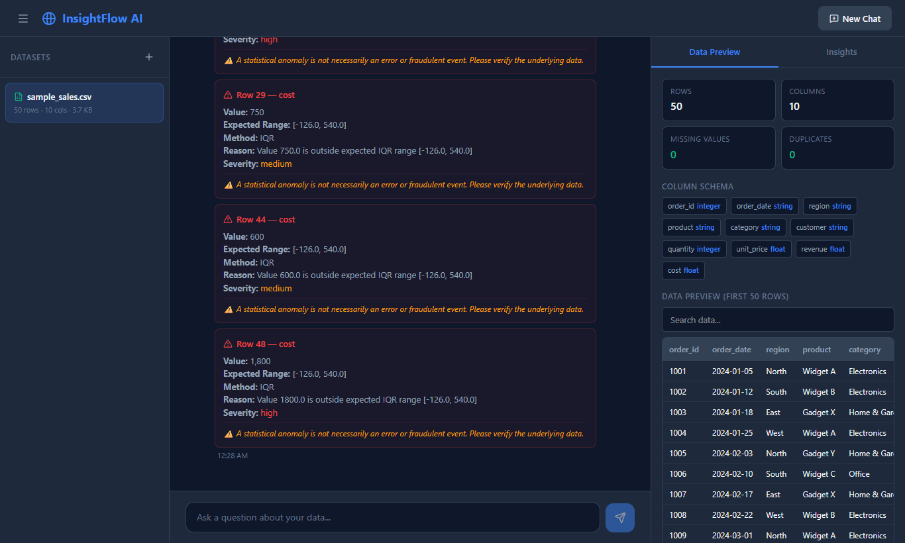
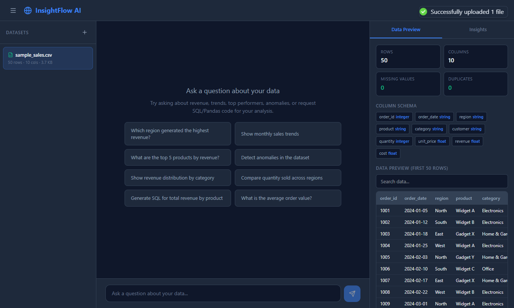
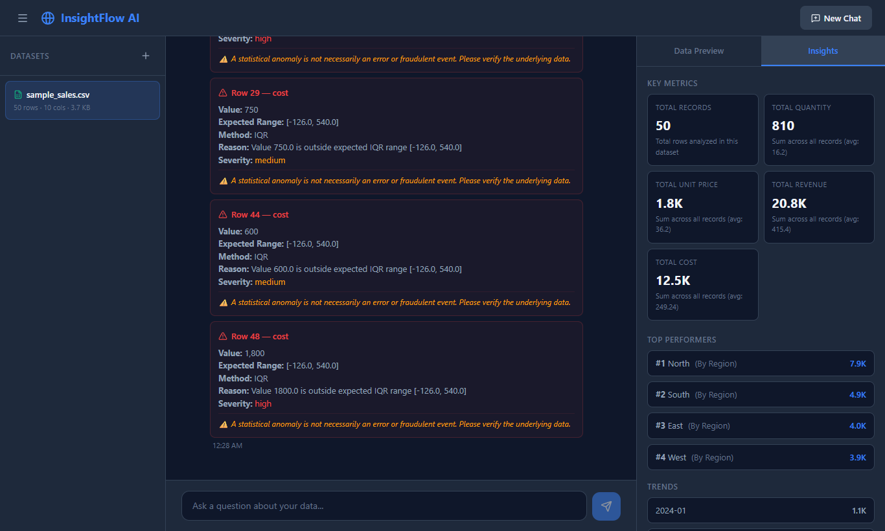
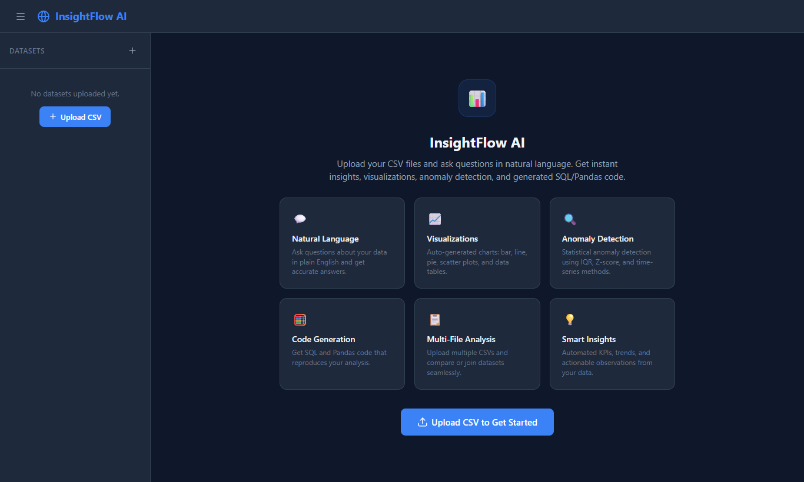
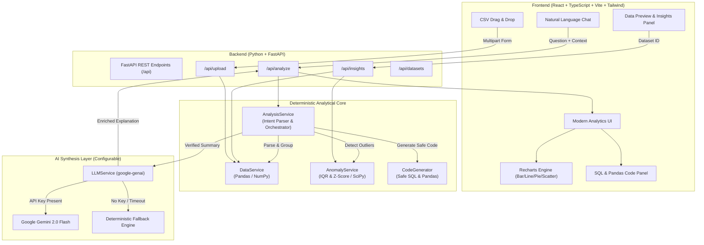

# InsightFlow AI — AI-Powered Data Analyst

InsightFlow AI is an end-to-end, production-grade **AI-powered Data Analyst** that enables users to upload CSV files and analyze complex tabular data using natural-language questions.

Unlike simple wrappers around an LLM chat prompt, InsightFlow AI executes **deterministic, verified calculations** in application code (Pandas, NumPy, SciPy) and uses AI strictly for query interpretation, analytical planning, and synthesis. Calculations, statistical anomaly detection, and chart generations are mathematically verified and reproducible.

---

## Table of Contents

1. [Key Features](#key-features)
2. [Application Demo Video & Screenshots](#application-demo-video--screenshots)
3. [Architecture & Data Flow](#architecture--data-flow)
4. [Technology Stack & Rationale](#technology-stack--rationale)
5. [Quick Start (Local Setup)](#quick-start-local-setup)
6. [Docker Setup](#docker-setup)
7. [LLM Configuration (Google Gemini)](#llm-configuration-google-gemini)
8. [Sample Datasets & Ground Truth](#sample-datasets--ground-truth)
9. [Example Questions to Try](#example-questions-to-try)
10. [How It Works](#how-it-works)
   - [Deterministic Computation](#deterministic-computation)
   - [Anomaly Detection](#anomaly-detection)
   - [Interactive Visualizations](#interactive-visualizations)
   - [Safe Code Generation](#safe-code-generation)
   - [Conversation Memory](#conversation-memory)
   - [Multi-File Analysis](#multi-file-analysis)
11. [Automated Test Suite](#automated-test-suite)
12. [Deployment Guide](#deployment-guide)
13. [GitHub Submission Instructions](#github-submission-instructions)
14. [Assumptions & Limitations](#assumptions--limitations)

---

## Key Features

- **Multi-File CSV Ingestion**: Drag-and-drop or file picker with client and server-side validation (schema inference, missing values, duplicate counts, encoding detection).
- **Interactive Data Preview**: Searchable, scrollable tabular inspection with column types and missing value badges.
- **Natural-Language Analysis**: Ask business questions in plain English; verified answers are backed by real computations.
- **Adaptive Visualizations**: Automatically selects and renders Bar Charts, Line Trends, Pie/Donut distributions, Scatter Plots, or Ranking Tables with dynamic chart type switching.
- **Statistical Anomaly Detection**: Interquartile Range (IQR) and Z-score methods flag mathematical outliers with expected ranges, severities, and non-accusatory explanations.
- **Safe SQL & Pandas Generation**: Deterministic, verified code snippets generated for transparency and reproducibility—no dangerous `eval()` or unconstrained execution.
- **Contextual Conversation Memory**: Understands follow-ups like *"Which one performed worst?"*, *"Show that by region"*, or *"What about the previous month?"*.
- **Intelligent Multi-File Merge**: Automatically detects compatible foreign keys (e.g. `region`) to join actuals against target budgets across separate files.
- **Automated Insights & KPIs**: Instant calculation of dataset summaries, top performers, and monthly trends upon upload.
- **Graceful Offline Mode**: 100% operational without an LLM key; template-based statistical synthesis operates with zero external network dependencies.

---

## Application Demo Video & Screenshots

### 🎬 Live Demo Screen Recording
A genuine 15.3-second screen recording showing CSV upload, data preview, natural-language query answering, dynamic chart rendering, generated code copy, statistical anomaly detection, and automated KPI insights:

- **Local Video Path**: [`docs/demo/insightflow-demo.mp4`](docs/demo/insightflow-demo.mp4) (15.3s, 1280×720 HD, 1.28 MB)

---

### Application Screenshots

### 1. Natural Language Data Analysis & Visualizations
Chat interface displaying verified calculations, dynamic chart rendering, generated SQL & Pandas code, and statistical anomaly detection.


### 2. Dataset Inspection & Searchable Preview
Instant schema inference, row/column counts, missing value audit, duplicate detection, and live tabular data preview.


### 3. Automated Business Insights & KPIs
Automated calculation of key performance indicators, category rankings, monthly growth trends, and contextual question suggestions.


### 4. Welcoming Empty State
Clear guidance, feature cards, and example queries to help users get started.


---

## Architecture & Data Flow



---

## Technology Stack & Rationale

| Layer | Technology | Rationale |
| :--- | :--- | :--- |
| **Backend** | Python 3.11+, FastAPI, Uvicorn | Native support for data science libraries, async throughput, automated OpenAPI documentation. |
| **Data Processing** | Pandas 3.0, NumPy 2.0 | Standard for robust dataframe manipulation, aggregation, time series resampling, and multi-file joins. |
| **Statistics** | SciPy, Statsmodels | Rigorous statistical methods for skewness, IQR bounds, and Z-score outlier detection. |
| **Frontend** | React 19, TypeScript, Vite | Sub-second HMR, strict type safety, modular component hierarchy. |
| **Styling** | Tailwind CSS v4, Lucide Icons | Responsive modern dark-theme dashboard design with accessible color contrast and fluid layouts. |
| **Visualizations** | Recharts | Composable SVG-based charts with responsive containers, custom tooltips, and dynamic chart switching. |
| **LLM Provider** | Google Gemini API (`google-genai` SDK) | Low latency, generous free tier via AI Studio, structured JSON support, with 100% deterministic offline fallback. |
| **Containerization**| Docker & Docker Compose | Multi-stage builds, production Nginx reverse proxy, automated healthchecks. |
| **Testing** | Pytest, FastAPI TestClient (HTTPX) | Comprehensive unit, integration, and ground-truth verification test suite. |

---

## Quick Start (Local Setup)

### Prerequisites

- **Python**: 3.10 or higher
- **Node.js**: v18 or higher (v20+ recommended)
- **Git**

### 1. Clone & Setup Workspace

```bash
git clone <repository-url>
cd "Digital Back Office assignment"
```

### 2. Backend Setup

```bash
# Navigate to backend
cd backend

# Create and activate virtual environment (optional but recommended)
python -m venv venv
# On Windows:
.\venv\Scripts\activate
# On Linux/macOS:
source venv/bin/activate

# Install dependencies
pip install -r requirements.txt

# Configure environment variables
cp .env.example .env
# Edit .env to add your GEMINI_API_KEY (optional, see instructions below)

# Run the FastAPI server
python -m uvicorn app.main:app --host 0.0.0.0 --port 8000 --reload
```
The backend API is now running at `http://localhost:8000` (API documentation at `http://localhost:8000/docs`).

### 3. Frontend Setup

In a new terminal:

```bash
# Navigate to frontend
cd frontend

# Install dependencies
npm install

# Start Vite development server
npm run dev
```
Open `http://localhost:5173` in your browser.

---

## Docker Setup

Run the entire application stack in isolated containers with Docker Compose:

```bash
# From project root
docker compose up --build
```

- **Frontend**: `http://localhost:3000` (Nginx serving SPA and reverse-proxying API calls)
- **Backend API**: `http://localhost:8000`
- **Health check**: Built-in Docker health checks ensure frontend boots only after backend is healthy.

To stop:
```bash
docker compose down
```

---

## LLM Configuration (Google Gemini)

InsightFlow AI is fully operational without an API key. To enable natural-language explanations powered by Google Gemini:

1. Obtain a free API key from [Google AI Studio](https://aistudio.google.com/apikey).
2. Create or edit `backend/.env`:
   ```ini
   GEMINI_API_KEY=AIzaSy...your_key_here
   ```
3. Restart the backend server. The logs will confirm:
   ```
   INFO | app.main | Gemini LLM: enabled
   ```
If the key is omitted or invalid, the application seamlessly falls back to clear, template-based statistical synthesis with no downtime or unhandled errors.

---

## Sample Datasets & Ground Truth

The repository includes pre-built sample datasets under `backend/data/`:

### 1. `sample_sales.csv` (Primary Dataset)
- **Size**: 50 transactions across 2024
- **Columns**: `order_id`, `order_date`, `region`, `product`, `category`, `customer`, `quantity`, `unit_price`, `revenue`, `cost`
- **Ground Truth**:
  - **Total Revenue**: $20,770.00
  - **Highest Revenue Region**: North ($7,925.00 across 13 orders)
  - **Top Product by Revenue**: Widget A ($6,875.00)
  - **Underperforming Product**: Gadget Z ($1,040.00)
  - **Intentional Anomalies**:
    - Row 48: `quantity=200`, `revenue=3000.0` (Chi2 Corp bulk purchase)
    - Row 29: `quantity=50`, `revenue=1250.0`

### 2. `sample_targets.csv` (Multi-File Comparison)
- **Columns**: `region`, `target_revenue`, `budget`, `sales_rep_count`
- **Use Case**: Compare actual sales revenue against regional targets.

---

## Example Questions to Try

| Question | Analytical Operation | Expected Output |
| :--- | :--- | :--- |
| **"Which region generated the highest revenue?"** | Grouped aggregation on `region` sorted descending | North ($7,925.00) with Donut / Bar chart |
| **"Show monthly sales trends"** | Time series monthly aggregation over `order_date` | 12-month Line Chart peaking in December |
| **"What are the top 5 products by revenue?"** | Aggregation on `product` with `LIMIT 5` | Bar chart: Widget A, Widget C, Widget B, Gadget X, Gadget Y |
| **"Which products are underperforming?"** | Ascending aggregation on `product` | Gadget Z ($1,040.00) and Gadget Y ($1,920.00) |
| **"Detect anomalies in the dataset"** | IQR statistical outlier analysis on numerical fields | 10 flagged records (quantity=200, revenue=3000) with ranges |
| **"Show revenue distribution by category"** | Percentage breakdown by category | Electronics, Office, Home & Garden breakdown |
| **"Generate SQL to calculate revenue by product"** | Deterministic SQL generator | Valid executable SQL query with `GROUP BY` and `ORDER BY` |
| **"Which one performed worst?"** (Follow-up) | Contextual resolution from previous question | Resolves previous metric and dimension with reverse sort |
| **"Compare revenue with target revenue by region"** | Multi-file merge on `region` foreign key | Comparison table and chart of actuals vs target |

---

## How It Works

### Deterministic Computation
All math is calculated by verified Python algorithms using Pandas and NumPy. When a user asks *"Which region generated the highest revenue?"*, the system:
1. Fuzzy-matches `region` to the categorical column and `revenue` to the numeric column.
2. Executes `df.groupby('region')['revenue'].sum().sort_values(ascending=False)`.
3. Verifies that North = $7,925.00.
4. Returns the exact numbers to the frontend.

The LLM is **never** asked to perform arithmetic.

### Anomaly Detection
The statistical engine uses:
- **IQR (Interquartile Range)** for skewed distributions: $Q_1 - 1.5 \times IQR$ and $Q_3 + 1.5 \times IQR$.
- **Z-Score** ($|z| > 3$) for normal distributions.
- Every anomaly card displays the **observed value**, **expected boundary**, **method used**, **severity**, and a clear disclaimer that statistical anomalies are not necessarily data entry errors or fraud.

### Safe Code Generation
Generated SQL and Pandas code is strictly deterministic and allowlisted. The application **never** calls `eval()`, unrestricted `exec()`, or executes raw SQL strings against a live database.

---

## Automated Test Suite

The test suite covers unit logic, edge cases, integration endpoints, and ground truth accuracy:

```bash
cd backend
$env:PYTHONPATH="." ; python -m pytest tests/ -v
```

### Verified Test Results
```
tests/test_analysis_service.py::test_question_highest_revenue_region PASSED
tests/test_analysis_service.py::test_question_monthly_trend PASSED
tests/test_analysis_service.py::test_question_top_products PASSED
tests/test_analysis_service.py::test_question_anomalies PASSED
tests/test_analysis_service.py::test_question_underperforming PASSED
tests/test_analysis_service.py::test_multi_file_analysis PASSED
tests/test_analysis_service.py::test_conversation_context_followup PASSED
tests/test_analysis_service.py::test_generated_sql_included PASSED
tests/test_anomaly_service.py::test_detect_anomalies_sample_data PASSED
tests/test_anomaly_service.py::test_detect_anomalies_specific_column PASSED
tests/test_anomaly_service.py::test_explain_anomaly PASSED
tests/test_anomaly_service.py::test_anomaly_no_data PASSED
tests/test_api_endpoints.py::test_health_check PASSED
tests/test_api_endpoints.py::test_upload_csv PASSED
tests/test_api_endpoints.py::test_dataset_list_and_preview PASSED
tests/test_api_endpoints.py::test_analyze_endpoint PASSED
tests/test_api_endpoints.py::test_insights_endpoint PASSED
tests/test_code_generator.py::test_generate_sql_simple PASSED
tests/test_code_generator.py::test_generate_sql_with_filter PASSED
tests/test_code_generator.py::test_generate_pandas PASSED
tests/test_data_service.py::test_validate_csv_valid PASSED
tests/test_data_service.py::test_validate_csv_empty PASSED
tests/test_data_service.py::test_validate_csv_malformed PASSED
tests/test_data_service.py::test_column_analysis PASSED
tests/test_data_service.py::test_compute_aggregation PASSED
tests/test_data_service.py::test_compute_ranking PASSED
tests/test_data_service.py::test_filter_data PASSED
tests/test_data_service.py::test_detect_date_columns PASSED
tests/test_data_service.py::test_compute_time_series PASSED
tests/test_data_service.py::test_compute_correlation PASSED

======================== 30 passed in 0.65s ========================
```

---

## Deployment Guide

### Option 1: Docker (Recommended)
Deploy on any cloud VM (AWS EC2, DigitalOcean Droplet, GCP Compute Engine):
```bash
git clone <repo>
docker compose up -d --build
```

### Option 2: Render / Railway / Fly.io
- **Backend**: Deploy `backend/` as a Python web service running `python -m uvicorn app.main:app --host 0.0.0.0 --port $PORT`.
- **Frontend**: Deploy `frontend/` as a Static Site with build command `npm run build` and publish directory `dist`. Configure `VITE_API_URL` to point to the backend URL.

---

## GitHub Submission Instructions

To push this repository to GitHub under the designated repository name `ai-powered-data-analyst`:

```bash
# 1. Open terminal in the project directory
cd "d:\AllProjects\Digital Back Office assignment"

# 2. Add your GitHub remote repository (replace YOUR_USERNAME with your GitHub username)
git remote add origin https://github.com/YOUR_USERNAME/ai-powered-data-analyst.git

# 3. Rename branch to main if desired
git branch -M main

# 4. Push verified commits and tags
git push -u origin main
```

---

## Assumptions & Limitations

1. **Session-Scoped Storage**: Uploaded datasets are stored in-memory in `app.state.datasets` for the duration of the server session. No persistent database is required.
2. **File Size**: Maximum supported file size is 50MB per CSV to prevent memory exhaustion.
3. **Data Security**: Uploaded files remain strictly within your local environment. Data rows are never transmitted to third-party LLMs; only schema definitions and aggregated summary totals are sent for narrative synthesis.

---

## License

MIT License. Designed and engineered for the Digital Back Office AI Engineer Assignment.
